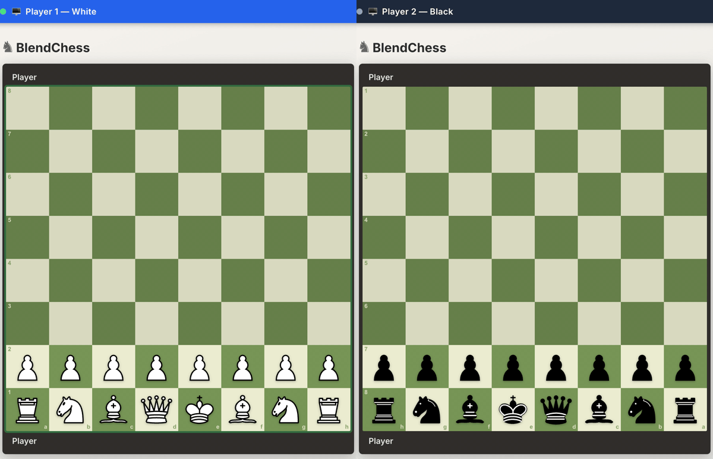

# Blendchess

Blendchess is a chess game where the information is intentionally limited in a [Kriegspiel](https://en.wikipedia.org/wiki/Kriegspiel_(chess)) style.



## What is different from normal online chess?

- The rules are classical chess; with a subtle difference: **you can only see your own pieces, and nothing else!**
- An umpire announces what both players would hear in Kriegspiel: someone moved, a piece was captured (and where), someone tried an illegal move.
- Check is announced only to the player in check, together with where it comes from (file, rank, diagonal or knight).
- Once the game ends the fog lifts: replay every move and export the PGN.

## Why the name Blendchess?

Well, blindchess is taken, and blind+chess is too long, and the game is literally fun blendy mess.

## Modes

- `Local Duel`: pass-and-play on one device. The board flips to the side to move and shows only their pieces; a banner on top says whose turn it is and what the opponent just did.
- `Online`: create a room, send the invite link, play. Reconnects resume your seat automatically.
- `Watch`: spectators see the fog too, unless the host turns on **party mode** (live full board for the audience).
- `Archive`: finished games are saved on your device for replay and PGN export.

## Rules in plain English

- Legal moves, check, checkmate, stalemate, castling, promotion, and en passant follow standard chess logic (I won against a friend using en-passant by mistake once!)
- Draw logic includes threefold/fivefold repetition, 50/75-move rule, and insufficient material.
- Online mode is authoritative: the backend validates moves, and each player only ever receives their own view of the game.
- Hard mode is optional: illegal moves forfeit the turn (recorded as `--` in the PGN), except when the mover is in check.
- Rules options lock once the first move is played. A draw offer stands until the opponent moves. Rematches swap colours.

## How to play

1. Open the game in your browser and press start.
2. Pick `Local Duel` or `Create Room` (share the invite link), or `Join Room` with a code.
3. Click or drag your pieces. Dots mark squares that *might* be legal; dashed corners are pawn captures worth a try. Keyboard works too: arrows, Enter, Esc.
4. Offer a draw or resign when needed. After the game: replay, PGN, rematch.

Retro extras: four palettes (the colour dots in the top bar), CRT scanlines, chiptune sound effects and optional music. Motion effects respect `prefers-reduced-motion`.

## Origin (Kriegspiel)

Blendchess is inspired by **Kriegspiel**, a historical chess variant built around incomplete information and an umpire ([Wikipedia](https://en.wikipedia.org/wiki/Kriegspiel_(chess))).
This project keeps core chess structure but adds selective hidden information to create a similar tension in online play.

## Motivation

This project initially started as a benchmark to test the latest Codex-Spark model ([OpenAI announcement](https://openai.com/index/introducing-gpt-5-3-codex-spark/)).

The first results were not great, so I decided to keep building it a few minutes a day, step by step, while playing with friends.
The goal is to make it stable enough to have fun in real places and parties.

I regularly used 5.3-Codex-Xhigh for core game logic, Opus 4.6 for frontend work, and some Gemini 3.0 Pro along the way.

## What's next

- Kriegspiel pawn-try announcements ("any captures?") as an optional rule.
- Clocks.
- Leaderboards, rankings, fun stuff.

## How to run on your own

### Local frontend only

```bash
python3 -m http.server 8080
```

Then open `http://localhost:8080`.

### Local multiplayer backend (Node)

```bash
cd server
npm install
npm start
```

Use `ws://localhost:3000` in the app.

### Cloudflare backend (Pages + Worker Durable Object)

Deploy Worker backend:

```bash
cd ws-worker
npx wrangler login
npx wrangler deploy
```

Deploy frontend to Pages:

```bash
npx wrangler pages project create blendchess
npx wrangler pages deploy . --project-name=blendchess
```

Use `wss://<worker-subdomain>.workers.dev` as the server URL in the app (OPTIONS > ADVANCED). Each room runs in its own Durable Object.

To set a default server URL, define before loading `app.js`:

```html
<script>
  window.BLENDCHESS_SERVER_URL = 'wss://blendchess-ws.<subdomain>.workers.dev';
</script>
```

## Notes

- The server redacts every message per viewer, so the dev console shows only your own pieces and moves. Spectating your own game from a second tab shows the fog too (unless party mode is on).
- Stale online snapshots are rejected by version checks.
- PGN export is enabled only after the game ends.
- Spectator roster is shown as count, not spectator name list.

## Tests

```bash
cd server && npm ci && npm test        # engine perft, room logic, session, Node end-to-end
cd ws-worker && npm ci && npm test     # Durable Object (mocked hibernation API)
# same end-to-end suite against the real Worker runtime:
cd ws-worker && npx wrangler dev --port 8787 &
cd server && E2E_URL=ws://127.0.0.1:8787 node --test tests/server-e2e.test.mjs
```

## Documentation

- `ARCHITECTURE.md` — system design, component boundaries, scaling direction.
- `multiplayer-schema.md` — WebSocket protocol envelope and message schema.
- `server/README.md` — Node backend specifics.
- `ws-worker/README.md` — Cloudflare Worker backend specifics.

## License

Licensed under the Apache License, Version 2.0. See [LICENSE](LICENSE).
